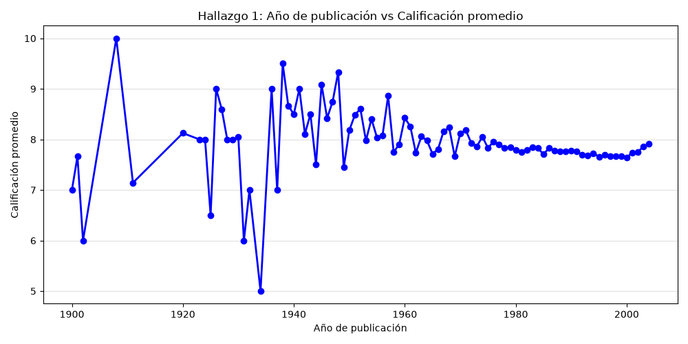
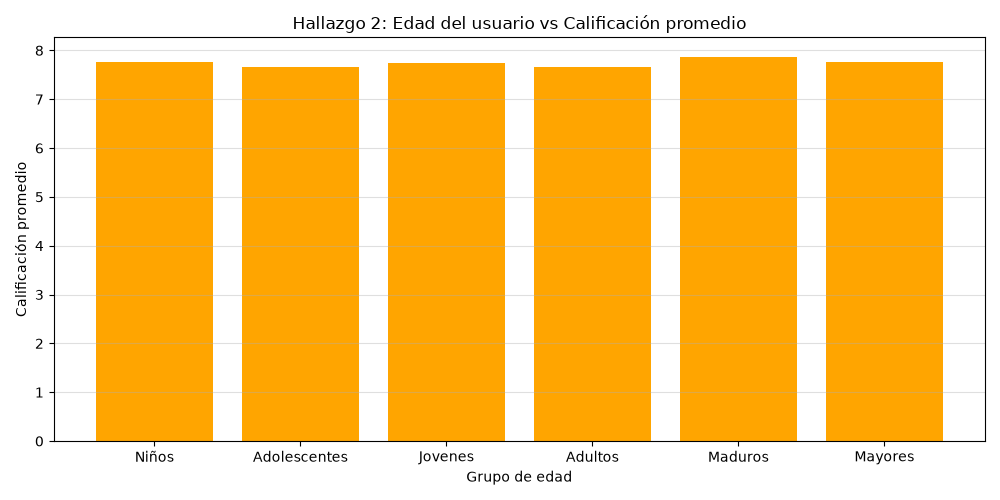
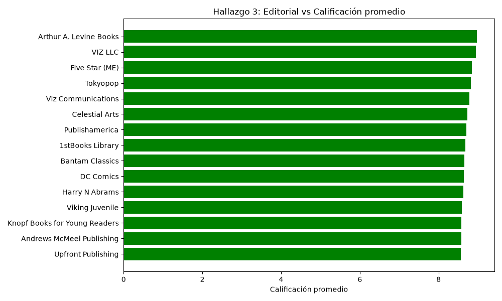
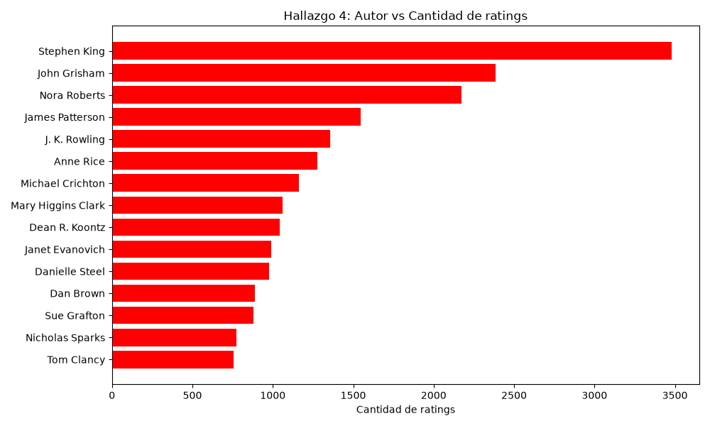

# Book Rating Analysis

> **Resumen en español.** Este repositorio es una versión revisada del proyecto final de Ingeniería de la Información (Universidad de Ibagué, 2026-1). Analiza el dataset Book-Crossing (libros, usuarios y calificaciones) con un pipeline ETL → EDA → modelos en Python. Se estudia si el año de publicación, la edad del usuario, la editorial y el autor se relacionan con las calificaciones, y se comparan cuatro modelos predictivos con un baseline. El código y los comentarios están en español; esta documentación está en inglés.

This is a revised version of the final project for *Ingeniería de la Información* (Information Engineering), Universidad de Ibagué, 2026-1. Because of the revisions listed under [Changes from the original project](#changes-from-the-original-project), the metrics may differ from the original report.

## What it does

`src/proyecto.py` is a single script that:

1. Loads and merges the books, users and ratings tables, then cleans them (ETL).
2. Explores four questions about what relates to book ratings and saves a chart for each one (EDA).
3. Trains four simple models on the explicit ratings and compares each one with a naive baseline.

## Problem

Can basic information about a book and its reader predict how much the reader will like the book?
The project looks at four candidate factors:

| # | Question | Type |
|---|---|---|
| H1 | Does the year of publication relate to the average rating? | Numeric |
| H2 | Does the user's age relate to the average rating? | Numeric |
| H3 | Which publishers have the highest average ratings? | Categorical |
| H4 | Which authors receive the most ratings? | Categorical |

## Dataset

The project uses the Book-Crossing dataset (Ziegler et al., 2005), downloaded from Kaggle.
It has about 271,000 books, 279,000 users and 1.15 million ratings.
A rating of `0` is an implicit interaction; ratings `1`–`10` are explicit.

The full dataset is **not** included in this repository. A small reproducible sample is
included in `data/sample/`. See [`data/README.md`](data/README.md) for the source, citation,
license notes and download instructions.

## Pipeline

```
Books.csv ─┐
Users.csv ─┼─► ETL ─► EDA (4 charts) ─► Models vs. baselines
Ratings.csv┘
```

**ETL**
- Merges ratings with books (on `ISBN`) and users (on `User-ID`).
- Keeps publication years between 1801 and 2004. The data was collected in 2004, so later years are entry errors.
- Keeps user ages between 5 and 100.
- Groups author and publisher names that differ only in letter case or surrounding spaces. Each group is shown with its most frequent original spelling.
- Result on the full dataset: **738,184 ratings**, of which **263,857 are explicit** (rating > 0).

**EDA.** All analyses use only explicit ratings. Publisher and author averages only include names
with at least 50 explicit ratings (`--min-ratings`).

**Models.** All models use an 80/20 train/test split with `random_state=42`.

| # | Model | Features | Target |
|---|---|---|---|
| H1 | Linear regression | Year | Rating (1–10) |
| H2 | Random forest regressor | Age, year | Rating (1–10) |
| H3 | Random forest classifier | Age, year | High (≥ 5) / Low |
| H4 | Decision tree (depth 5) | Age, year | Low (1–3) / Medium (4–6) / High (7–10) |

Baselines: `DummyRegressor(strategy="mean")` for the regressions and
`DummyClassifier(strategy="stratified", random_state=42)` for the classifiers.

## Findings

The charts below come from the full dataset. Their titles are in Spanish, like the code.

**H1 – Year of publication vs. average rating**



The average rating is almost flat (about 7.7–8.0) for books published since the 1970s. The large swings before about 1960 come from years with very few ratings, and the correlation is close to zero (−0.014).

**H2 – User age vs. average rating**



The average rating barely changes across age groups (7.65–7.87), and the correlation between age and rating is close to zero (0.026).

**H3 – Publisher vs. average rating (publishers with ≥ 50 explicit ratings)**



The top 15 publishers all average between 8.6 and 9.0. Children's and young-adult imprints, manga and comics publishers stand out.

**H4 – Author vs. number of ratings**



Ratings are concentrated on a few best-selling authors. Stephen King alone has 3,478 explicit ratings, about 46% more than the runner-up, John Grisham (2,383).

## Results vs. baseline

Full dataset, test set of 52,772 explicit ratings.

| # | Model | Metric | Model | Baseline |
|---|---|---|---|---|
| H1 | Linear regression | RMSE | 1.8165 | 1.8166 |
|    |                   | R²   | 0.0002 | −0.0000 |
| H2 | Random forest regressor | RMSE | 1.8080 | 1.8166 |
|    |                         | R²   | 0.0095 | −0.0000 |
| H3 | Random forest classifier | F1 macro | 0.4901 | **0.5030** |
| H4 | Decision tree | F1 macro | 0.2928 | **0.3336** |

F1 per class:

| # | Class | Model | Baseline |
|---|---|---|---|
| H3 | High | 0.979 | 0.960 |
|    | Low  | 0.001 | 0.046 |
| H4 | High   | 0.875 | 0.779 |
|    | Low    | 0.000 | 0.017 |
|    | Medium | 0.004 | 0.204 |

In short:
- The regressions are only marginally better than always predicting the mean rating.
- Both classifiers score **below** their stratified baseline on macro F1. They predict the majority class ("High") almost every time and miss the minority classes.

## Limitations

- **Very few features.** Each model uses one or two variables: year of publication and user age. Nothing describes the book's content or genre, and nothing describes the user's reading history.
- **Low R², and why.** Year and age are almost uncorrelated with the rating (|r| < 0.03). Most of the variation in ratings depends on the specific user–book pair, which these features cannot capture. Explicit ratings are also skewed towards high values (mean 7.74, standard deviation 1.81), so there is little variance left to explain.
- **Class imbalance.** Only 4% of explicit ratings are below 5, and only 2% are between 1 and 3. Without any correction, the classifiers learn to predict the majority class.
- **Implicit ratings are excluded.** Ratings of `0` (about 64% of the rows after the ETL) are not used in the EDA or the models.
- **Data quality.** Some names in the source files have broken character encoding (for example `Saint-Exupéry`). Name normalization only merges differences in letter case and spacing, so variants such as `Bantam` and `Bantam Books` are still counted separately.
- **Sample results are not meaningful.** The sample in `data/sample/` is only meant to check that the pipeline runs. Its metrics are noisy and should not be compared with the table above.

### Next steps

- Train the classifiers with `class_weight="balanced"` so that minority classes count more during training. This is not implemented yet.
- Add features that describe the book and the user, such as genre, past ratings or the average rating of each book.

## How to run it

Requires **Python 3.13** (tested with 3.13.15). Run all commands from the repository root.

```bash
python -m venv .venv
# Windows (PowerShell):  .venv\Scripts\Activate.ps1
# macOS / Linux:         source .venv/bin/activate
pip install -r requirements.txt
```

The script calls `plt.show()`. To save the charts without opening windows, set the
Matplotlib backend to `Agg` first:

```bash
# Windows (PowerShell):  $env:MPLBACKEND = "Agg"
# macOS / Linux:         export MPLBACKEND=Agg
```

**With the sample (no download needed).** The sample is small, so lower the minimum number of
ratings per publisher/author and write the charts to a separate folder. This keeps the
full-dataset charts in `reports/figures/` unchanged.

```bash
python src/proyecto.py --data-dir data/sample --min-ratings 5 --figures-dir reports/sample_figures
```

**With the full dataset.** Download it into `data/raw/` first (see [`data/README.md`](data/README.md)).

```bash
python src/proyecto.py --data-dir data/raw
```

| Option | Default | Description |
|---|---|---|
| `--data-dir` | `data/raw` | Folder with `Books.csv`, `Ratings.csv` and `Users.csv` |
| `--figures-dir` | `reports/figures` | Folder where the charts are saved |
| `--min-ratings` | `50` | Minimum explicit ratings for a publisher or author to be averaged |

To rebuild the sample from the full dataset: `python src/make_sample.py`.

## Project structure

```
book-rating-analysis/
├── data/
│   ├── README.md          # Source, citation, license notes, download steps
│   ├── raw/               # Full dataset (not in the repository)
│   └── sample/            # Reproducible sample
├── reports/
│   └── figures/           # Charts generated from the full dataset
├── src/
│   ├── proyecto.py        # ETL, EDA and models
│   └── make_sample.py     # Builds data/sample/ from data/raw/
├── requirements.txt
├── LICENSE
└── README.md
```

## Changes from the original project

- Fixed `random_state=42` in every split and model, so results can be reproduced.
- Added baselines (`DummyRegressor`, `DummyClassifier`) and macro F1.
- The EDA justification section now uses only explicit ratings.
- Tighter ETL filters: publication year 1801–2004 (previously > 1800) and age 5–100 (previously 5–120).
- Author and publisher names are grouped case-insensitively. Publisher and author averages require a minimum number of ratings.
- Added command-line options for the data folder, figures folder and minimum number of ratings, plus a reproducible data sample.

## Authors

- **Rosa Isabel Peña Yagüe**: all the code (ETL, EDA and models).
- **Daniel Guzmán**: co-author of the academic project.

## License

The code is released under the [MIT License](LICENSE). The license does **not** cover the
data, which belongs to its original authors. See [`data/README.md`](data/README.md).
